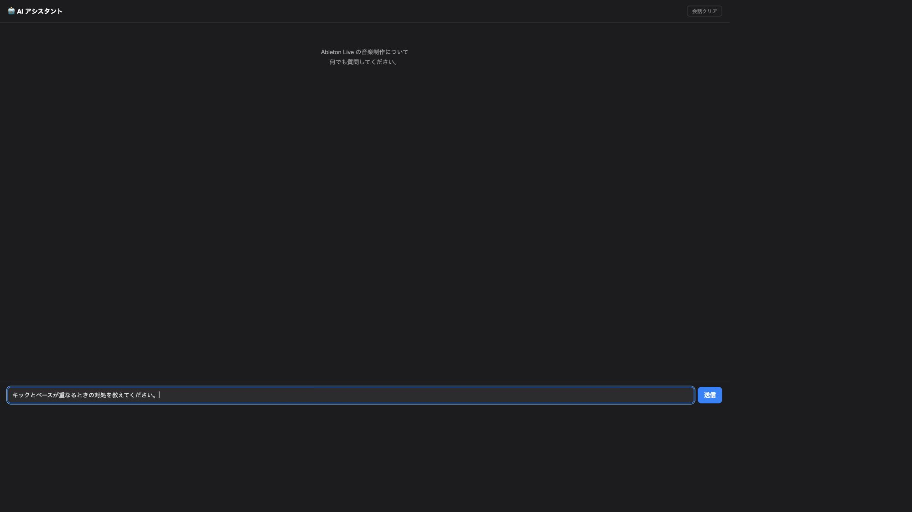
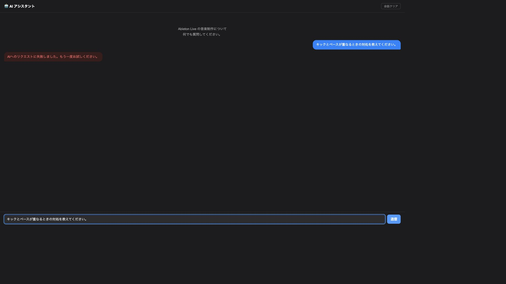
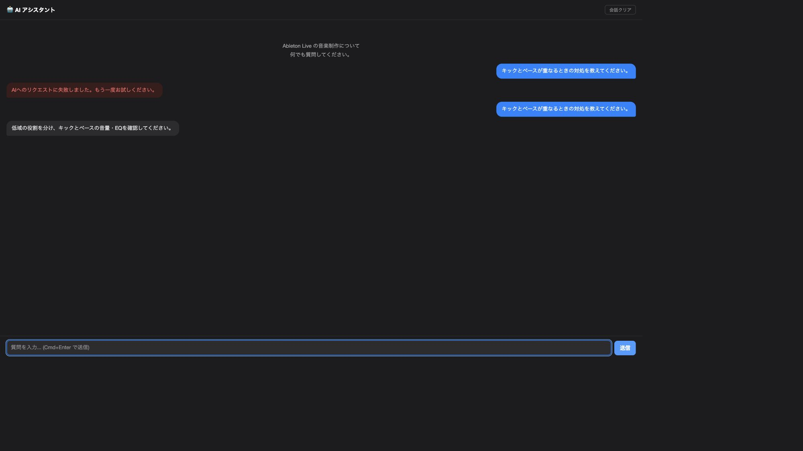

# セキュリティ・パフォーマンス・UI/UX監査（2026-10-25）

監査で見つかった保存時の安全性、統計更新、エラー復旧の問題を修正した。実アプリへの反映・commit・pushは行っていない。

対象は LES の設定保存、プラグイン統計、お気に入り、プロジェクト／トラックメモ、AIチャット。基点は `084b631d29f48eda7d0dfd9d0286c5df2af53273`、ブランチは `codex/audit-ui-ux-security-performance`。開始時から存在した `.claude/settings.local.json` の削除は保持し、今回の作業では触れていない。

## 指摘と修正

| 観点 | 優先度 | 確認した問題 | 修正と検証した結果 |
| --- | --- | --- | --- |
| セキュリティ | P1 | 共通保存の一時ファイルへ機密を書いた後に権限を変更し、権限変更失敗も保存を継続していた | 最初の書き込み前に所有者のみ読み書き可能な600を適用。失敗時は書き込み・元ファイルの置換を拒否。既存の一時パスがリンク等なら開かない |
| データ保全 | P1 | 壊れた／読み取れないメモを空データと扱い、追加操作で元の履歴を隠す・置換する可能性があった | ファイルなしと読み込み失敗を区別。失敗時の追加・削除を拒否。開く時とプロジェクト切替確定時にも再確認し、旧画面・保存先を保持 |
| 安定性 | P2 | メモと統計の外部JSONに非有限値・極端な時刻・不正な型があると表示処理が停止し得た | 日付として描画できる整数時刻のみ受理。統計の件数・レコード・お気に入りを正規化し、不正値の例外を防止 |
| 性能 | P2 | 同じタイミングの利用記録ごとに統計全体を保存していた | 次の実行ループまでの記録を1回に集約。21イベントで1タイマー・1書き込み、件数とお気に入りを保持することを検証 |
| 保存整合性／UX | P2 | 統計の書き込み失敗でも変更済みキャッシュやお気に入り表示が残り得た | 永続化成功後だけキャッシュを更新。write・close・rename失敗で元ファイルと旧状態を保持。お気に入り保存失敗は日英の警告で通知 |
| UI/UX／APIコスト | P2 | AI失敗時に入力した質問が消え、失敗した質問が会話履歴に残った。ネイティブ受信側の同時送信防止もなかった | 失敗時は質問と入力フォーカスを復元。完了した会話だけ最大20メッセージ保持。処理中の重複送信を拒否し、再試行時に失敗した質問をAPI履歴へ重複追加しない |

設定保存では後段の権限取得用 `stat` 子プロセスも不要になった。統計の公開取得結果は独立コピーとし、呼び出し元によるキャッシュ破壊を防ぐ一方、お気に入り判定は内部キャッシュを直接読む。連続イベント集約以外の実機応答時間改善を測定したわけではない。

不正なプロジェクトメモのブリッジメッセージ本文をログに出す処理も撤去した。実キーの流出を確認したわけではなく、利用者の設定や資格情報は取得していない。

## 検証

- 開始時：Lua 225件成功、静的解析57警告・0エラー。
- 新しい不具合は対象の回帰テストで失敗を確認してから修正した。既存契約に合わせたテスト用モックの修正と、既に実装された失敗経路の追加確認については、動作中のコードを意図的に壊す操作をしていない。
- 最終の統合Luaテスト：249件成功、0失敗・0エラー。
- 実際に埋め込むJavaScriptのNodeテスト：21件成功、0失敗。既存のIME・キーボード・メモ切替に加え、AI失敗時の入力復元・再有効化・フォーカスを確認。
- 静的解析：56警告・0エラー。既存の許容上限62以内。警告ゼロという意味ではない。
- 権限テストでは実一時ファイルの `rw-------` を確認。保存用モックでは書き込み前の権限確定、権限失敗時の非書き込み、既存リンクの非オープンを確認。
- メモの実一時ファイルを使うテストでは、壊れた元ファイルのバイト列とファイル数を保持し、新形式のファイルで履歴を隠さないことを確認。画面契約テストでは、切替確認中に読み込み不能になった場合も旧プロジェクトへ保存することを確認。
- 統計のwrite・close・rename失敗時に、元JSON・お気に入り・件数を保持することを確認。壊れたJSONへの利用記録は保存せず、元データを保持。
- AIチャットは、処理中の2送信が1要求になること、失敗後の再試行がsystem＋userの2メッセージになること、成功した会話が次の要求に残ることを検証。
- `git diff --check` 成功。

主な再実行コマンド（リポジトリルートで実行）：

```sh
docker run --rm -v "$PWD:/app:ro" -w /app les-test:latest sh scripts/run-lua-tests.sh
node --test extensions/les/tests/ui_keyboard_spec.mjs
git diff --check
```

## UI/UX画面監査：AIの失敗から再送まで

Product Designの監査手順に従い、今回取得・保存した画面を根拠に操作の復旧性を確認した。製品のLua `buildHTML` が生成するHTMLをローカルブラウザーで表示し、ネイティブ通信ブリッジだけを模擬した。最初の送信には失敗、次の送信には成功を返す固定応答であり、実OpenAIの応答ではない。

### 1. 質問入力 — 良好

日本語の質問が入力欄に表示され、質問用のアクセシビリティラベルと送信操作が存在する。



### 2. 送信失敗・再試行待ち — 問題を修正、確認範囲では良好

修正前は失敗後の入力欄が空になった。修正後はエラーを表示しながら元の質問とフォーカスを復元し、送信ボタンが再利用できる。



### 3. 同じ質問を再送・成功 — 模擬応答で良好

復元した質問を再送し、応答表示・入力欄のクリア・次の入力へのフォーカスを確認した。画面上には失敗した試行と再送が残るが、APIへ送る履歴では失敗した試行を重複保持しない。



証拠の保存先：`docs/audit/2026-10-25/`。画像は取得した画面そのものであり、合成・補正していない。

## 確認範囲と残る実機確認

- ブラウザー画面は大きい既定ビューポート。実アプリの小さいWKWebView、リサイズ、高倍率、実IME、VoiceOver、Abletonとの連携を実機で確認したわけではない。
- お気に入りとメモの画面についてはLua／JavaScript契約の確認であり、今回の画像ベース監査に含めていない。製品全画面・全操作が良好と判定したわけではない。
- 一時パスの事前検査は既存リンク等の追跡を拒否するが、同一ユーザー権限の攻撃者との競合に対する完全なTOCTOU対策ではない。保存先の私有ディレクトリが信頼できる前提を維持する。今回の共通保存の権限強化は、全ての独自JSONライターを置き換える変更ではない。
- 統計更新の集約は同じ実行ループ内のバーストが対象。読み書きに失敗した利用記録は診断ログを残して保存しない。永続的な再送キューではない。
- 同梱Sparkleは既存の2.9.6を維持。確認に参照した一次情報は[公式リリース](https://github.com/sparkle-project/Sparkle/releases)、[セキュリティ案内](https://sparkle-project.org/documentation/security-and-reliability/)、[公開アドバイザリー](https://github.com/sparkle-project/Sparkle/security/advisories)。全依存ライブラリに問題がないという網羅的な保証ではない。
- 今回はLuaのみの修正で、ネイティブビルド・署名・公証・アプリ入れ替え・起動・実API通信・OS権限変更・CI実行・デプロイは行っていない。以前のビルド結果を今回の成果物の検証として再利用していない。
- プロジェクト全体の80%カバレッジは今回計測していない。テスト件数だけでこの目標を達成したと判定していない。

次の実機確認は、監査したLuaを反映したアプリでAI失敗→再送、メモの読み込み失敗、お気に入り保存失敗の復旧を順に確認すること。
